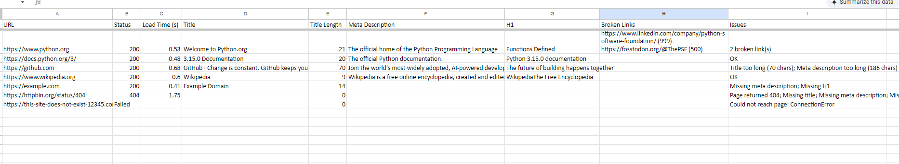

# SEO Checker

A Python command-line tool that audits a list of websites for basic SEO problems and saves the results to an Excel report. Useful for quickly checking client or campaign landing pages without opening each one by hand.

## What it checks

| Check | Flagged when |
|---|---|
| Page status | Page returns an error (4xx/5xx) or can't be reached |
| Load time | Page takes longer than 3 seconds |
| Title | Missing, or longer than 60 characters |
| Meta description | Missing, or longer than 160 characters |
| H1 heading | Missing |
| Broken links | Links on the page that return an error (first 15 by default) |

## Installation

```bash
git clone https://github.com/<your-username>/seo-checker.git
cd seo-checker
python -m venv venv
venv\Scripts\activate        # Windows
# source venv/bin/activate   # macOS / Linux
pip install -r requirements.txt
```

## Usage

1. Put the URLs in a CSV file, one per row, under a header (see `urls.csv`):

   ```
   url
   https://www.python.org
   https://example.com
   ```

2. Run:

   ```bash
   python seo_checker.py urls.csv
   ```

3. Open `seo_report.xlsx`.

### Options

```bash
python seo_checker.py urls.csv -o client_report.xlsx   # custom output name
python seo_checker.py urls.csv --max-links 5           # check fewer links (faster)
```

## Example output

```
Checking https://www.python.org ...
Checking https://example.com ...

Done. 2 pages checked, 1 with no issues.
Report saved to seo_report.xlsx
```


## How it works

1. **Read** URLs from the CSV with pandas (adds `https://` if missing).
2. **Fetch** each page with `requests` and time the response.
3. **Parse** the HTML with BeautifulSoup to get the title, meta description and H1.
4. **Check links** on the page with lightweight HEAD requests.
5. **Flag issues** against simple SEO rules.
6. **Save** everything to a formatted Excel sheet.

Errors (timeouts, bad URLs, DNS failures) are caught per site, so one bad URL never stops the whole run.

## Future improvements

- Email the report automatically on a schedule
- Check image `alt` text and mobile viewport tags
- Run checks in parallel for large URL lists
- Add a simple web interface

## Tech stack

Python, requests, BeautifulSoup, pandas, openpyxl
